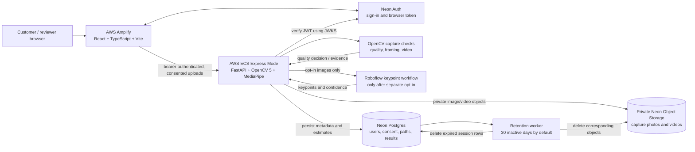

# VisionFit architecture

## Decision and action loop

1. OpenCV checks exposure, blur, framing and capture evidence. A failed capture asks for a retake;
   uncertain posture or framing requests human review.
2. If the customer separately opts in, the service sends capture images to the Roboflow keypoint
   workflow. The stored keypoints and their confidence become input to the administrator-published,
   versioned COCO v6 measurement paths.
3. A missing keypoint segment blocks the affected value and identifies the view/segment to correct.
   Successful path execution still returns `review_required`; it never approves a body profile.
4. Measurement estimates must be checked with a tape. No accuracy claim or export approval is
   inferred from passing image-quality checks.

The measurement path is deterministic orchestration over computer-vision output; it is not a
general-purpose autonomous agent. No COOL component is part of the current workload.
